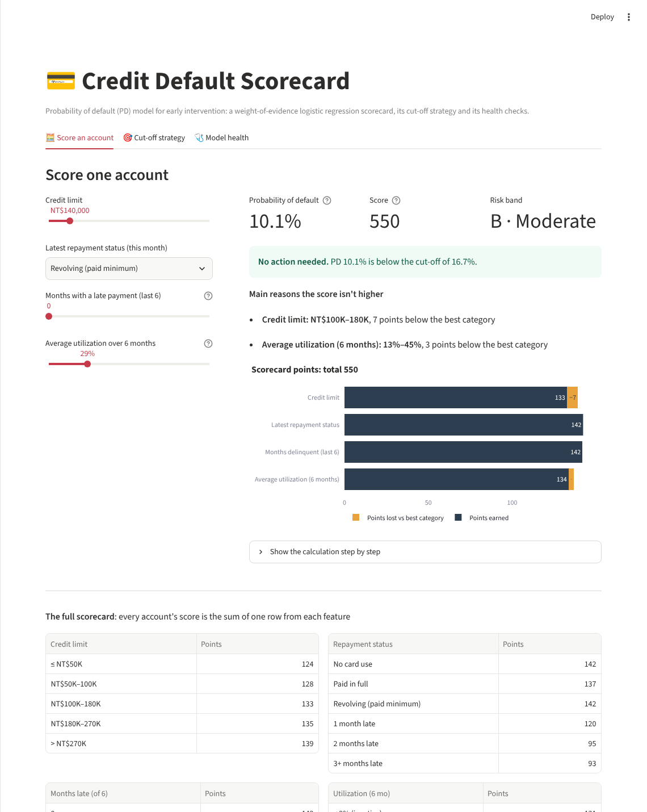
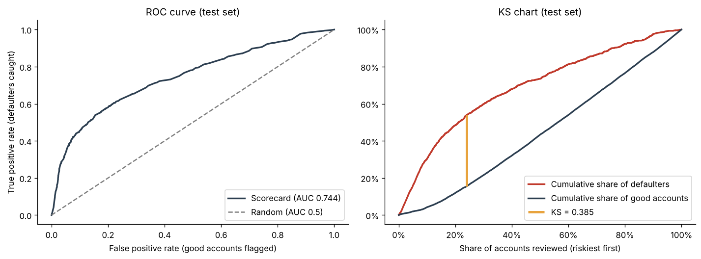
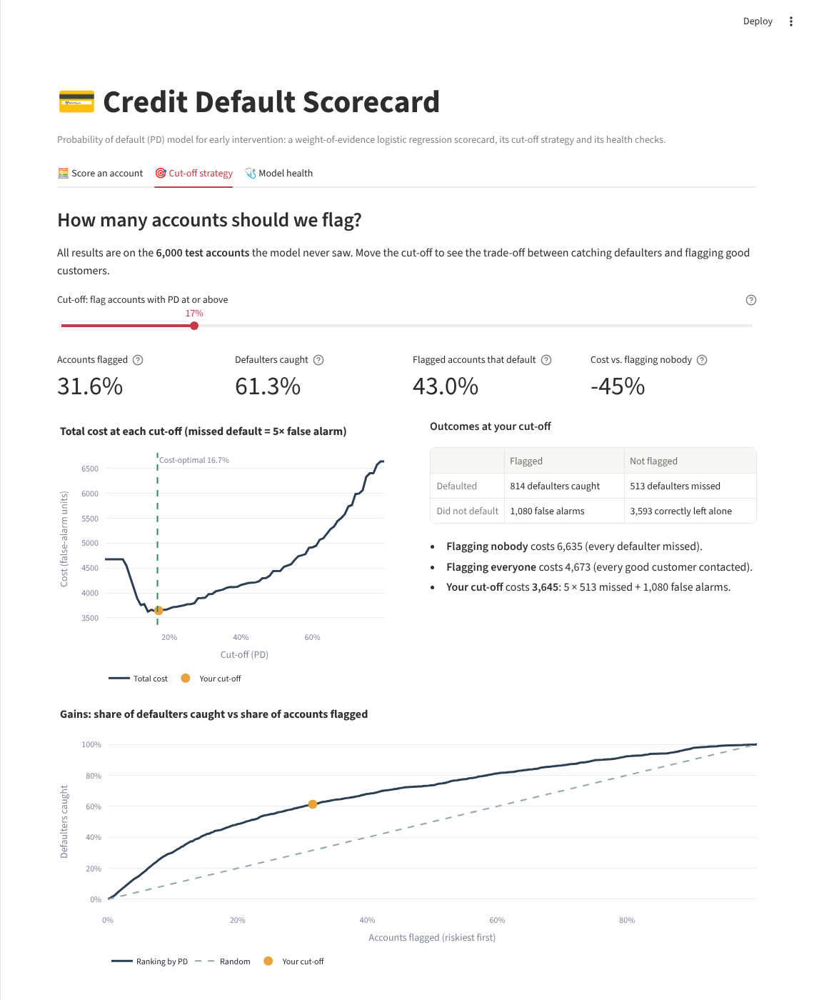
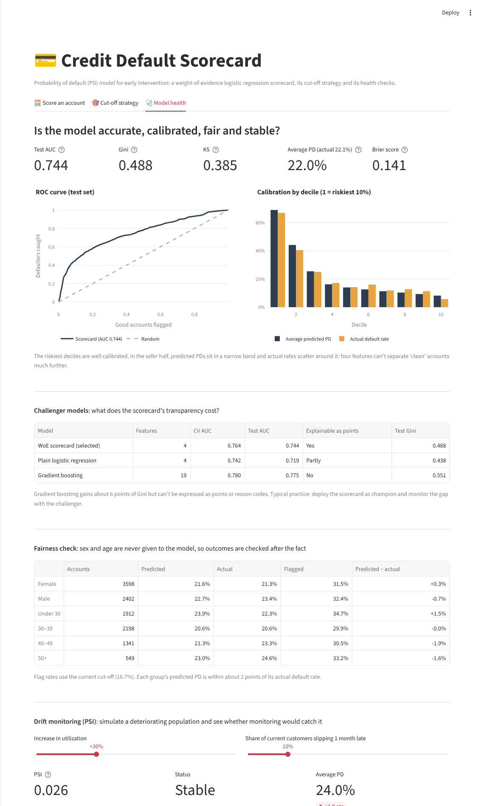

# Credit Card Default Prediction with Logistic Regression

A **probability of default (PD) scorecard** that flags credit card accounts likely to default next month, so a bank can step in early with a reminder, a payment plan or a limit review. Built the way regulated credit-risk models are built: weight-of-evidence binning, an interpretable logistic regression, a points-based scorecard, a cost-based cut-off, challenger models, a fairness check and drift monitoring. Delivered through an **interactive Streamlit dashboard**.

**▶ Live dashboard: [YOUR-APP-URL](https://credit-default-scorecard.streamlit.app/)** · [Notebook](notebooks/credit_default_logistic_regression.ipynb) · [Deployment guide](DEPLOY.md)



## Business problem

Most credit losses on cards are visible in the months before default: late payments, rising balances, minimum-only payments. A model that converts that behaviour into a calibrated PD lets a collections or risk team contact the right customers early, and choose how many to contact based on what a missed default costs compared with an unnecessary call.

## Data

[Default of Credit Card Clients](https://archive.ics.uci.edu/dataset/350/default+of+credit+card+clients) (UCI Machine Learning Repository; Yeh & Lien, 2009): 30,000 cardholders at a bank in Taiwan, six months of history (April–September 2005) and whether they defaulted in October. Default rate 22.1%. Amounts are in New Taiwan dollars (NT$).

## Approach

1. **Data quality:** no missing values or duplicates; undocumented codes in education, marital status and repayment status, with each decision documented.
2. **Fair lending:** sex, marital status and age (protected grounds under the Canadian Human Rights Act) and education (a likely proxy) are **excluded** from the model.
3. **Feature engineering:** credit limit, latest repayment status, months delinquent in the last 6, average utilization, and payment ratio (with payments aligned to the bill they paid).
4. **Weight of evidence (WoE) and information value (IV):** each feature is binned and encoded, with one bin worked through by hand. WoE captures non-linear patterns, such as inactive cards being riskier than lightly used ones.
5. **Feature selection:** payment ratio had a medium IV (0.12) but added nothing once repayment history was in the model (p = 0.24), so it was dropped. The final scorecard has **4 features**.
6. **Logistic regression with `statsmodels`:** all coefficients negative as expected, all p < 0.001, VIFs below 2.4.
7. **Class imbalance handled in the cut-off, not by re-weighting:** re-weighting kept the AUC but inflated the average PD from 22% to 44%.
8. **Evaluation:** AUC, Gini and KS (calculated step by step), decile calibration and Brier score.
9. **Cost-based cut-off:** flag when PD > C_false_alarm ÷ (C_false_alarm + C_missed), confirmed empirically.
10. **Scorecard:** 600 points at 50:1 odds, 20 points to double the odds; every score is the sum of four points values.
11. **Challengers, fairness and monitoring:** plain logistic regression and gradient boosting as challengers; calibration and flag rates by sex and age; population stability index (PSI) with stress scenarios.

## Results (test set, 6,000 accounts)

| Model | Features | CV AUC | Test AUC | Test Gini | Explainable as points |
|---|---|---|---|---|---|
| **WoE scorecard (selected)** | 4 | **0.764** | **0.744** | **0.488** | Yes |
| Plain logistic regression | 4 | 0.742 | 0.719 | 0.438 | Partly |
| Gradient boosting | 19 | 0.780 | 0.775 | 0.551 | No |

- **KS 0.39:** reviewing the riskiest 24% of accounts finds 54% of defaulters but only 16% of good accounts.
- **Calibrated:** average predicted PD 22.0% vs 22.1% actual; the riskiest deciles are within a few points of their actual default rates.
- **At a 5:1 cost ratio** (cut-off PD 16.7%): 32% of accounts flagged, 61% of defaulters caught, total cost 45% lower than flagging nobody.
- **WoE beats plain logistic regression on the same four features** (Gini 0.49 vs 0.44) by capturing non-linear patterns.
- **Gradient boosting is about 6 Gini points better**, but it can't produce points or reason codes, so it serves as a challenger rather than the deployed model.



## Key decisions and findings

- **Repayment-status categories kept separate.** "No card use", "paid in full" and "revolving" are different behaviours, not degrees of lateness. Merging them into one "current" bin lowered cross-validated AUC from 0.765 to 0.761.
- **A feature with a decent IV can still be redundant.** Payment ratio overlapped with the delinquency features and was dropped.
- **Re-weighting for imbalance breaks PDs.** Calibrated probabilities are what make the cost-based cut-off and any expected-loss use valid.
- **Fairness after exclusion:** each sex and age group's average predicted PD is within 2 points of its actual default rate. The model slightly over-predicts for under-30s and under-predicts for 40+.
- **PSI only notices large shifts:** a mild deterioration (utilization +30%, 10% of current customers slipping) gives PSI 0.03, which reads as "stable"; a severe one gives 0.16. PSI has to be monitored alongside actual default rates.

## Interactive dashboard

| Tab | What it does |
|---|---|
| **Score an account** | Enter an account's limit, repayment status, months late and utilization. Get its PD, score, risk band and early-intervention decision, the **main reasons** the score isn't higher, a points chart, and the full calculation step by step |
| **Cut-off strategy** | Set the cost of a missed default vs a false alarm (sidebar) and the cut-off. See accounts flagged, defaulters caught, precision, total cost, the outcomes table, the cost curve and the gains chart |
| **Model health** | AUC, Gini, KS, calibration by decile, challenger comparison, fairness table, and a PSI stress test with adjustable deterioration |

<details>
<summary>Cut-off strategy and model health screenshots</summary>




</details>

## Limitations

- One bank in Taiwan in 2005, during a card-debt crisis: the method transfers, the numbers don't.
- Predicts default next month; regulatory PD models (IFRS 9, Basel) use 12-month and lifetime horizons.
- A behavioural model for existing customers; it can't approve new applicants.
- The meaning of repayment codes −2 and 0 is an interpretation that would need confirming with the data owner.
- Limited separation among "clean" accounts: most current, never-late customers get PDs between 8% and 14%.

## Model ownership

If this were deployed, I'd maintain a model card; monitor score and feature PSI monthly and AUC, KS, decile calibration and the fairness table quarterly; set review triggers (PSI > 0.25, Gini more than 5 points below development, calibration drift); and keep the gradient-boosting challenger running in parallel, in line with the bank's model risk management policy (e.g. OSFI Guideline E-23). The automated tests in `tests/` check that the dashboard reproduces the notebook's results.

## Project structure

```
├── app.py                      # Streamlit dashboard
├── src/credit_model.py         # Scorecard code shared by the dashboard (mirrors the notebook)
├── notebooks/
│   └── credit_default_logistic_regression.ipynb   # Full analysis, commented step by step
├── tests/test_app.py           # Automated checks for the model and the dashboard
├── data/credit_card_default.csv
├── reports/figures/            # Charts and dashboard screenshots
├── requirements.txt            # Packages for the dashboard (used by Streamlit Cloud)
├── requirements-dev.txt        # Adds notebook and test packages, for local work
└── DEPLOY.md                   # Step-by-step: run locally, push to GitHub, deploy
```

## How to run

```bash
git clone https://github.com/DataKritii/credit-default-logistic-regression.git
cd credit-default-logistic-regression
pip install -r requirements-dev.txt

streamlit run app.py          # the dashboard, at http://localhost:8501
jupyter notebook              # the analysis notebook
pytest tests/                 # the automated tests
```

## Tech stack

Python · pandas · statsmodels · scikit-learn · Streamlit · Plotly · matplotlib · pytest
